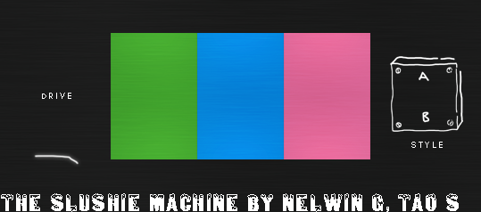

# The Slushie Machine

The Slushie Machine is a VST3 effects plugin that Nelwin and I built in JUCE for our Music Technology capstone at Northeastern. It takes incoming audio and runs it through a fixed chain of effects (stereo imager, chorus, filters, delay, drive and a limiter), and the whole chain is controlled with five knobs.

## Why we made it

We are both producers, and we wanted to make an effects plugin that adds simplicity and creative freedom to any workflow. We believe that a simple interface will appeal to a wider audience, especially people who are newer to production. Rather than giving each effect its own set of controls, we mapped several parameters onto a single knob, so turning one knob changes more than one effect at the same time. This takes away some fine control from the user. However, it keeps the interface small, and it makes the plugin something you play with rather than something you have to program.

## Finding the "recipe"

The plugin is designed to modify incoming audio, not to generate new sound. Before writing any DSP code, we spent hours in FL Studio and Ableton Live chaining effects together to find the sound we were going for. Since each effect stays the same, the order of the chain and the amount of each effect are what make the result. Once we had a chain we liked, we rebuilt it in JUCE and tuned the range of each parameter by testing the plugin in both DAWs.

## Signal chain

Audio goes through the effects in this order (see `processBlock` in `Source/PluginProcessor.cpp`):

1. **Stereo imager** - mid/side widening, width from 1 to 5
2. **Chorus** - JUCE `dsp::Chorus` with the rate fixed at 0.5 Hz
3. **Filters** - a 20 Hz high-pass to clear out rumble, and a low-pass Butterworth filter (20 Hz - 20 kHz)
4. **Delay** - feedback delay, up to 50 ms
5. **Drive** - gain from 1x to 12x, followed by a waveshaper
6. **Safety limiter** - compressor at a 100:1 ratio (10 ms attack, 40 ms release, -6 dB threshold) to keep peaks under control

## Controls

| Knob | What it controls |
|---|---|
| Drive (top left) | Gain into the waveshaper and limiter, 1x to 12x |
| Low-pass (bottom left) | Low-pass cutoff, 20 Hz to 20 kHz |
| Knob 1 (middle, left) | Chorus depth, chorus feedback (up to 0.1) and delay feedback (up to 0.8) |
| Knob 2 (middle, center) | Chorus centre delay (up to 15 ms) and delay time (up to 50 ms) |
| Knob 3 (middle, right) | Chorus mix and stereo width |

Turning Knob 2 all the way down turns the delay off completely.

## Building

The project was built on Windows with Visual Studio 2022. The generated Visual Studio project is not checked in, so you will need Projucer to create it.

1. Install [JUCE](https://juce.com/) and set the global JUCE modules path in Projucer.
2. Open `The Slushie Machine.jucer` in Projucer and save it. This generates the Visual Studio 2022 project in `Builds/VisualStudio2022`.
3. Open the solution in Visual Studio and build the VST3 target in Release.
4. Copy the built `.vst3` into `C:\Program Files\Common Files\VST3` and rescan plugins in your DAW.

The Projucer project is still named "The Slush Machine", so the plugin shows up under that name in your DAW.

## Tools we used

- **JUCE** - C++ framework for the plugin itself
- **Visual Studio** - development, building and debugging
- **JKnobMan** and **Photoshop** - knob filmstrips and the background (the source files are in `Images/` and `UI Design/`)
- **FL Studio** and **Ableton Live** - testing the plugin during actual production
- **GitHub** - version control between the two of us

## Known issues

The plugin works, but there are a few things that are not finished:

- The waveshaper's bypass parameter defaults to on and there is no button for it in the UI. In the current build, the Drive knob only adds gain into the limiter unless the bypass is turned off through host automation.
- There is no oversampling, so it should be assumed that the plugin introduces aliasing when the signal is heavily driven.
- The stereo imager assumes two channels, so the plugin should only be used on stereo tracks.
- The UI is a fixed 539 x 238 and does not resize.

If given more time, we would add a bypass button for the waveshaper, oversampling for the drive stage, presets, and a resizable UI.
